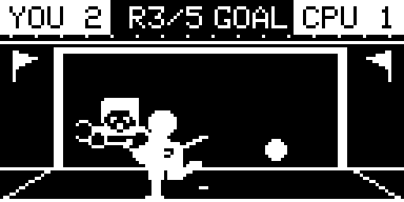
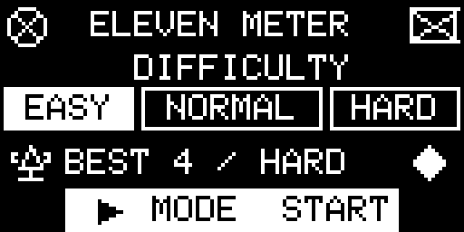
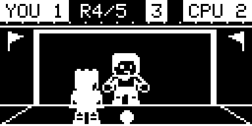
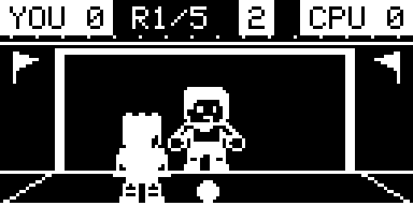
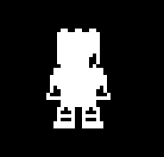
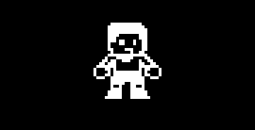
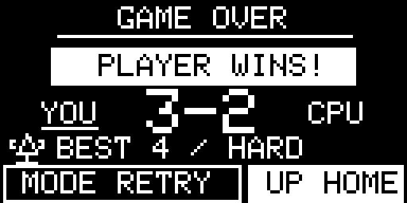
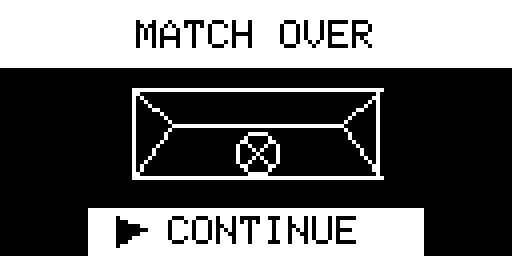

<div align="center">


</div>

<p align="center">
  
  
  
  
</p>

# Eleven Meter - Game built on AK Embedded Base Kit

<p align="center">
  
</p>

---

## Documentation

| File | Description |
| --- | --- |
| [README.md](README.md) | Project overview, hardware, gameplay rules, and game objects. |
| [docs/00-guide-getting-started.md](docs/00-guide-getting-started.md) | Build, flash, play, and inspect the game firmware. |
| [docs/01-guide-coding-rules.md](docs/01-guide-coding-rules.md) | Source layout, naming, formatting, and AK coding rules. |
| [docs/02-design-sequence-object.md](docs/02-design-sequence-object.md) | Ownership and message sequences for Match, Shooter, Ball, Keeper, Goal, and Display. |
| [docs/03-design-sequence-runtime.md](docs/03-design-sequence-runtime.md) | Runtime flow from button input to animation, result handling, and screen updates. |
| [docs/04-ak-mcp-deployment.md](docs/04-ak-mcp-deployment.md) | Deployment guide for the AK documentation MCP server. |
| [docs/05-review-and-validation.md](docs/05-review-and-validation.md) | Final review scope, build measurements, and engineer-confirmed board checks. |

## Introduction

Eleven Meter is a five-kick penalty shootout for the AK Embedded Base Kit. The player has three buttons, three shooting directions, and three seconds to make each decision. The goalkeeper reacts according to the selected difficulty, while the OLED shows the ball, goalkeeper response, and kick result. The shooter keeps the original standing bitmap and takes a small two-pixel step when shooting; raised-leg frames are not displayed.

The game is also a small example of event-driven firmware design:

- **System design:** Gameplay is split into objects with clear responsibilities.
- **Process management:** AK tasks run cooperatively without blocking delays.
- **Communication:** Signals and messages carry input, commands, results, and display snapshots.
- **Timing:** One 40 ms gameplay tick drives the match and object animations.

### Gameplay Demo

<p align="center">
  <a href="resources/videos/eleven_meter_demo.mp4">
    
  </a>
</p>

[Watch or download the demo (MP4)](resources/videos/eleven_meter_demo.mp4) — a 19.76-second
playback of OLED samples captured from the kit, covering all five rounds and the final
3–2 score. This is sampled screen playback, not a camera recording; UART transfer pauses
are excluded and there is no audio. See [video details and regeneration](resources/videos/README.md).

### I. Hardware

<table align="center">
  <tr>
    <td align="center"></td>
  </tr>
</table>
<p align="center"><strong><em>Figure 1:</em></strong> AK Embedded Base Kit - STM32L151</p>

The [AK Embedded Base Kit](https://epcb.vn/products/ak-embedded-base-kit-lap-trinh-nhung-vi-dieu-khien-mcu) is an evaluation board for intermediate and advanced embedded programming. Its 1.54-inch OLED, three push buttons, and buzzer make it suitable for a compact handheld game. RS485, Qwiic, and Grove connections are also available for other firmware experiments.

**MCU Overview:**

```text
SoC Name : STM32L151CBT6
RAM      : 16 KB

Flash Partitions Layout
-----------------------
[ 0x08000000 - 0x08001FFF ] : Bootloader Partition (8 KB)
=> AK Bootloader

[ 0x08002000 - 0x08002FFF ] : BSF Shared Partition (4 KB)
=> Data shared between Bootloader and Application

[ 0x08003000 - 0x0801FFFF ] : Application Partition (116 KB)
=> Eleven Meter firmware
```

**MCU Naming Convention:**

<div align="center">

| Part | Meaning |
| --- | --- |
| `STM32` | STMicroelectronics 32-bit MCU family. |
| `L` | Low-power series. |
| `151` | STM32L151 product line. |
| `C` | 48-pin package. |
| `B` | 128 KB Flash memory. |
| `T` | LQFP package. |
| `6` | Industrial temperature grade. |

</div>

<table align="center">
  <tr>
    <td align="center"></td>
  </tr>
</table>
<p align="center"><strong><em>Figure 2:</em></strong> Board view Top + Bottom</p>

### II. Game Description and Objects

The match starts at the difficulty menu. Easy gives the player the best chance against the goalkeeper, Normal keeps the contest balanced, and Hard makes correct saves more likely. After five kicks, the game compares the player's goals with the goalkeeper's saves and misses, stores the best result, and opens the Game Over screen.

<table align="center">
  <tr>
    <td align="center"></td>
  </tr>
</table>
<p align="center"><strong><em>Figure 3:</em></strong> Animated difficulty selection preview and saved best result</p>

<table align="center">
  <tr>
    <td align="center"></td>
  </tr>
</table>
<p align="center"><strong><em>Figure 4:</em></strong> On-device round playback: countdown, shot, goalkeeper response, and result</p>

#### Objects in the Game:

<div align="center">
<table>
  <thead>
    <tr>
      <th align="center">Bitmap</th>
      <th align="center">Object Name</th>
      <th align="center">Description</th>
    </tr>
  </thead>
  <tbody>
    <tr>
      <td align="center"></td>
      <td align="center"><strong>Match</strong></td>
      <td align="left">Coordinates the menu, round setup, countdown, accepted input, result phase, and screen transitions.</td>
    </tr>
    <tr>
      <td align="center"></td>
      <td align="center"><strong>Shooter</strong></td>
      <td align="left">Owns kick selection and a short two-pixel step using the original standing bitmap.</td>
    </tr>
    <tr>
      <td align="center"></td>
      <td align="center"><strong>Ball</strong></td>
      <td align="left">Moves from the penalty spot toward the chosen target. A rushed kick may travel wide.</td>
    </tr>
    <tr>
      <td align="center"></td>
      <td align="center"><strong>Keeper</strong></td>
      <td align="left">Chooses a dive from the shot direction and current difficulty, then animates the save attempt.</td>
    </tr>
    <tr>
      <td align="center"></td>
      <td align="center"><strong>Goal</strong></td>
      <td align="left">Waits for the Ball and Keeper reports, then resolves the kick as a goal, save, or miss.</td>
    </tr>
    <tr>
      <td align="center"></td>
      <td align="center"><strong>Scoreboard</strong></td>
      <td align="left">Tracks five rounds, all kick results, and the final winner.</td>
    </tr>
  </tbody>
</table>
</div>

Each gameplay task keeps its mutable state private. Objects work together through AK messages instead of reading or changing one another's data directly.

The Match GIF is a sampled UART recording of a complete five-round match, including the match-over transition and final score. The Shooter, Ball, and Keeper GIFs are isolated documentation previews made from the original bitmap bytes; they use current movement constants with idle/endpoint holds extended for readability. The goal artwork is static and rendered by Display; the Goal task only resolves reports. Scoreboard is illustrated by the generated Game Over screen preview; its data remains owned by Match. Match and Scoreboard have no standalone sprite, and Display is the rendering task rather than a gameplay object. See the [complete bitmap GIF gallery](resources/images/objects/README.md) for all eight gameplay assets, including retained shooter poses that are not used in the current animation. Regenerate the GIFs with `python3 tools/render_game_objects.py` (Pillow required).

> **Note:** For detailed object flows, see [Game Object Sequences](docs/02-design-sequence-object.md).

### III. How to Play:

- On the menu, press **[Up]** or **[Down]** to choose Easy, Normal, or Hard.
- Press **[Mode]** to start the shootout.
- During a round, press **[Up]** to shoot left, **[Mode]** to shoot center, or **[Down]** to shoot right.
- Choose before the three-second countdown ends. If time runs out, the shot goes to the center.

#### Game Mechanics:

- **Five kicks:** Every match contains five penalty attempts.
- **Winning:** Score at least three goals out of five. Saves and misses both count toward the CPU score.
- **Three results:** A kick ends as a goal, save, or miss.
- **Reaction pressure:** Shooting too quickly increases the chance of missing the target.
- **Difficulty:** The selected level changes how often the goalkeeper matches the shot direction.
- **Score:** The HUD shows the player score, CPU score, round number, and selection countdown.
- **Best result:** The highest goal count is stored together with its difficulty. An equal goal count on a harder difficulty replaces the previous record.
- **Game Over:** After the fifth result, a short RIP screen leads to the final score. Press **[Mode]** to retry or **[Up]** to return home.

<table align="center">
  <tr>
    <td align="center"></td>
    <td align="center"></td>
  </tr>
  <tr>
    <td align="center"><strong><em>Figure 5:</em></strong> Match-over transition</td>
    <td align="center"><strong><em>Figure 6:</em></strong> Final score and next actions</td>
  </tr>
</table>

### IV. Basic Game Sequence Logic

> **Note:** For the complete signal flow, see [Runtime Signal Processing](docs/03-design-sequence-runtime.md).

<table align="center">
  <tr>
    <td align="center"></td>
  </tr>
</table>
<p align="center"><strong><em>Figure 7:</em></strong> Basic game sequence from menu entry to Retry or Home</p>

The diagram follows the current message ownership: Display forwards input and drives the shared tick, Match coordinates rounds, Shooter commands Ball and Keeper, and Goal waits for both reports before resolving a kick. After five results, Match updates BEST when improved, stops the gameplay tick, and opens RIP followed by the final score screen.

This is a high-level sequence; exact signals, payloads, and timing are documented in the object and runtime guides. Regenerate the image with `python3 tools/render_game_sequence.py` (Pillow and DejaVu Sans fonts required; use `--font-dir` if the fonts are installed elsewhere).

## Contact & Support

<p style="font-size: 20px;"><strong>Cao Trong Phuoc</strong> - Software Engineer - Embedded Systems</p>

```text
Thank you for visiting this repository.
If you have questions, suggestions, or feedback about Eleven Meter or embedded firmware development, feel free to get in touch.
```

<a href="https://github.com/caotrongphuoc">
  
</a>

<a href="https://www.linkedin.com/in/cao-trong-phuoc/">
  
</a>
