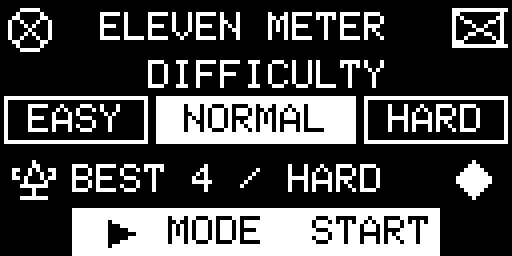

<div align="center">


</div>

<p align="center">
  
  
  
  
</p>

# Eleven Meter - Game built on AK Embedded Base Kit

---

## Documentation

| File | Description |
| --- | --- |
| [README.md](README.md) | Project overview, hardware, gameplay rules, and game objects. |
| [docs/01-guide-getting-started.md](docs/01-guide-getting-started.md) | Build, flash, play, and inspect the game firmware. |
| [docs/02-guide-coding-rules.md](docs/02-guide-coding-rules.md) | Source layout, naming, formatting, and AK coding rules. |
| [docs/03-design-sequence-object.md](docs/03-design-sequence-object.md) | Ownership and message sequences for Match, Shooter, Ball, Keeper, Goal, and Display. |
| [docs/04-design-sequence-runtime.md](docs/04-design-sequence-runtime.md) | Runtime flow from button input to animation, result handling, and screen updates. |
| [docs/05-ak-mcp-deployment.md](docs/05-ak-mcp-deployment.md) | Deployment guide for the AK documentation MCP server. |
| [docs/06-review-and-validation.md](docs/06-review-and-validation.md) | Final review scope, build measurements, and engineer-confirmed board checks. |

## Introduction

Eleven Meter is a five-kick penalty shootout for the AK Embedded Base Kit. The player has three buttons, three shooting directions, and three seconds to make each decision. The goalkeeper reacts according to the selected difficulty, while the OLED shows the ball, goalkeeper response, and kick result. The shooter keeps the original standing bitmap and takes a small two-pixel step when shooting; raised-leg frames are not displayed.

The game is also a small example of event-driven firmware design:

- **System design:** Gameplay is split into objects with clear responsibilities.
- **Process management:** AK tasks run cooperatively without blocking delays.
- **Communication:** Signals and messages carry input, commands, results, and display snapshots.
- **Timing:** One 40 ms gameplay tick drives the match and object animations.

### I. Hardware

<table align="center">
  <tr>
    <td align="center"></td>
  </tr>
</table>
<p align="center"><strong><em>Figure 1:</em></strong> AK Embedded Base Kit - STM32L151</p>

The [AK Embedded Base Kit](https://epcb.vn/products/ak-embedded-base-kit-lap-trinh-nhung-vi-dieu-khien-mcu) is an evaluation board for intermediate and advanced embedded programming. Its 1.54-inch OLED, three push buttons, and buzzer make it suitable for a compact handheld game. RS485, Qwiic, and Grove connections are also available for other firmware experiments.

**MCU Overview:**

```text
SoC Name : STM32L151CBT6
RAM      : 16 KB

Flash Partitions Layout
-----------------------
[ 0x08000000 - 0x08001FFF ] : Bootloader Partition (8 KB)
=> AK Bootloader

[ 0x08002000 - 0x08002FFF ] : BSF Shared Partition (4 KB)
=> Data shared between Bootloader and Application

[ 0x08003000 - 0x0801FFFF ] : Application Partition (116 KB)
=> Eleven Meter firmware
```

**MCU Naming Convention:**

<div align="center">

| Part | Meaning |
| --- | --- |
| `STM32` | STMicroelectronics 32-bit MCU family. |
| `L` | Low-power series. |
| `151` | STM32L151 product line. |
| `C` | 48-pin package. |
| `B` | 128 KB Flash memory. |
| `T` | LQFP package. |
| `6` | Industrial temperature grade. |

</div>

<table align="center">
  <tr>
    <td align="center"></td>
  </tr>
</table>
<p align="center"><strong><em>Figure 2:</em></strong> Board view Top + Bottom</p>

### II. Game Description and Objects

The match starts at the difficulty menu. Easy gives the player the best chance against the goalkeeper, Normal keeps the contest balanced, and Hard makes correct saves more likely. After five kicks, the game compares the player's goals with the goalkeeper's saves and misses, stores the best result, and opens the Game Over screen.

<table align="center">
  <tr>
    <td align="center"></td>
  </tr>
</table>
<p align="center"><strong><em>Figure 3:</em></strong> Difficulty selection and saved best result</p>

<table align="center">
  <tr>
    <td align="center"></td>
  </tr>
</table>
<p align="center"><strong><em>Figure 4:</em></strong> Penalty animation, score HUD, and kick result</p>

> **Display preview:** Figures 3–6 are generated illustrations using the firmware's OLED primitives, font, and bitmap data, not captured board frames. Regenerate them with `python3 tools/render_game_screens.py` (Pillow required). The [shooter animation strip](resources/images/screens/scr_game_shooter_frames.png) shows preparation, the small step, and recovery. For a board framebuffer capture, enable diagnostic console output as described in [Getting Started](docs/01-guide-getting-started.md#inspect-the-board) before using `lcd d`.

#### Objects in the Game:

<div align="center">
<table>
  <thead>
    <tr>
      <th align="center">Object Name</th>
      <th align="center">Description</th>
    </tr>
  </thead>
  <tbody>
    <tr>
      <td align="center"><strong>Match</strong></td>
      <td align="left">Coordinates the menu, round setup, countdown, accepted input, result phase, and screen transitions.</td>
    </tr>
    <tr>
      <td align="center"><strong>Shooter</strong></td>
      <td align="left">Owns kick selection and a short two-pixel step using the original standing bitmap.</td>
    </tr>
    <tr>
      <td align="center"><strong>Ball</strong></td>
      <td align="left">Moves from the penalty spot toward the chosen target. A rushed kick may travel wide.</td>
    </tr>
    <tr>
      <td align="center"><strong>Keeper</strong></td>
      <td align="left">Chooses a dive from the shot direction and current difficulty, then animates the save attempt.</td>
    </tr>
    <tr>
      <td align="center"><strong>Goal</strong></td>
      <td align="left">Waits for the Ball and Keeper reports, then resolves the kick as a goal, save, or miss.</td>
    </tr>
    <tr>
      <td align="center"><strong>Scoreboard</strong></td>
      <td align="left">Tracks five rounds, all kick results, and the final winner.</td>
    </tr>
    <tr>
      <td align="center"><strong>Display</strong></td>
      <td align="left">Keeps the validated render snapshot and draws the menu, pitch, sprites, HUD, RIP, and Game Over screens.</td>
    </tr>
  </tbody>
</table>
</div>

Each gameplay task keeps its mutable state private. Objects work together through AK messages instead of reading or changing one another's data directly.

> **Note:** For detailed object flows, see [Game Object Sequences](docs/03-design-sequence-object.md).

### III. How to Play:

- On the menu, press **[Up]** or **[Down]** to choose Easy, Normal, or Hard.
- Press **[Mode]** to start the shootout.
- During a round, press **[Up]** to shoot left, **[Mode]** to shoot center, or **[Down]** to shoot right.
- Choose before the three-second countdown ends. If time runs out, the shot goes to the center.

#### Game Mechanics:

- **Five kicks:** Every match contains five penalty attempts.
- **Winning:** Score at least three goals out of five. Saves and misses both count toward the CPU score.
- **Three results:** A kick ends as a goal, save, or miss.
- **Reaction pressure:** Shooting too quickly increases the chance of missing the target.
- **Difficulty:** The selected level changes how often the goalkeeper matches the shot direction.
- **Score:** The HUD shows the player score, CPU score, round number, and selection countdown.
- **Best result:** The highest goal count is stored together with its difficulty. An equal goal count on a harder difficulty replaces the previous record.
- **Game Over:** After the fifth result, a short RIP screen leads to the final score. Press **[Mode]** to retry or **[Up]** to return home.

<table align="center">
  <tr>
    <td align="center"></td>
    <td align="center"></td>
  </tr>
  <tr>
    <td align="center"><strong><em>Figure 5:</em></strong> Match-over transition</td>
    <td align="center"><strong><em>Figure 6:</em></strong> Final score and next actions</td>
  </tr>
</table>

### IV. Basic Game Sequence Logic

> **Note:** For the complete signal flow, see [Runtime Signal Processing](docs/04-design-sequence-runtime.md).

```text
Main Menu
    |
    v
Select Difficulty
    |
    v
Start Match -> Round Setup -> Three-Second Selection
                                  |
                       +----------+----------+
                       |          |          |
                      Left      Center      Right
                       +----------+----------+
                                  |
                                  v
                              Shooter
                             /       \
                            v         v
                          Ball      Keeper
                            \         /
                             v       v
                        Goal Evaluation
                                  |
                    +-------------+-------------+
                    |                           |
               Next Round                  Match Complete
                                                |
                                                v
                                        RIP -> Game Over
                                                |
                                         Retry or Home
```

## Build and validation status

The current play configuration disables all six console print/debug flags. See [Getting Started](docs/01-guide-getting-started.md) for build, Type-C UART flashing, and a temporary diagnostic build.

Firmware `33ac918` was built and flashed successfully: application Flash **51,216 / 118,784 bytes**, RAM **13,636 / 16,384 bytes**. The engineer confirmed five-round play across all difficulties, timeout handling, Retry/Home, BEST persistence after power-off, and no recurrence of the earlier MF31 failure during their checks. These are manual confirmations; no test duration or match count was recorded. See the [review and validation record](docs/06-review-and-validation.md) for evidence and limits.

## Contact & Support

<p style="font-size: 20px;"><strong>Cao Trong Phuoc</strong> - Software Engineer - Embedded Systems</p>

```text
Thank you for visiting this repository.
If you have questions, suggestions, or feedback about Eleven Meter or embedded firmware development, feel free to get in touch.
```

<a href="https://github.com/caotrongphuoc">
  
</a>

<a href="https://www.linkedin.com/in/cao-trong-phuoc/">
  
</a>
