<div align="center">


</div>

<p align="center">
  
  
  
  
</p>

# Eleven Meter - Game built on AK Embedded Base Kit

<p align="center">
  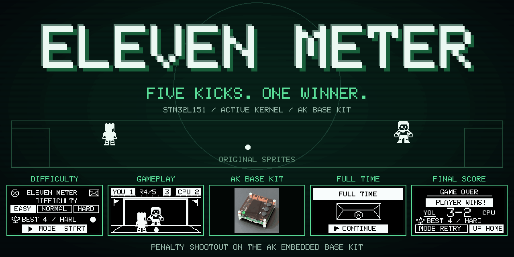
</p>

---

## Gameplay Demo

<p align="center">
  <a href="resources/videos/eleven_meter_demo.mp4">
    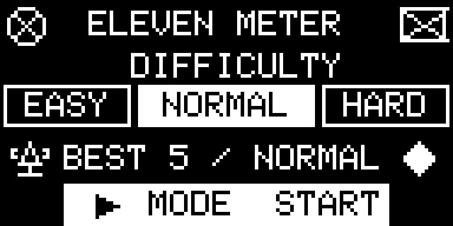
  </a>
</p>

## Documentation

| File | Description |
| --- | --- |
| [README.md](README.md) | Project overview, hardware, gameplay rules, and game objects. |
| [docs/01-guide-coding-rules.md](docs/01-guide-coding-rules.md) | Source layout, naming, formatting, and AK coding rules. |
| [docs/02-design-sequence-object.md](docs/02-design-sequence-object.md) | Ownership and message sequences for Match, Shooter, Ball, Keeper, Goal, and the Scoreboard helper. |
| [docs/03-design-sequence-runtime.md](docs/03-design-sequence-runtime.md) | Runtime flow from button input to animation, result handling, and screen updates. |
| [docs/04-ak-mcp-deployment.md](docs/04-ak-mcp-deployment.md) | Deployment guide for the AK documentation MCP server. |

## Introduction

Eleven Meter is a five-kick penalty shootout built on the AK Embedded Base Kit. Choose a shooting direction with three buttons, beat the goalkeeper, and score at least three goals to win. The project demonstrates event-driven embedded game design through:

- **System design:** Gameplay is split into objects with clear responsibilities.
- **Process management:** AK tasks run cooperatively without blocking delays.
- **Communication:** Signals and messages carry input, commands, results, and display snapshots.
- **Control logic:** State machines coordinate kick selection, animation, round results, and the final score.

### I. Hardware

<table align="center">
  <tr>
    <td align="center">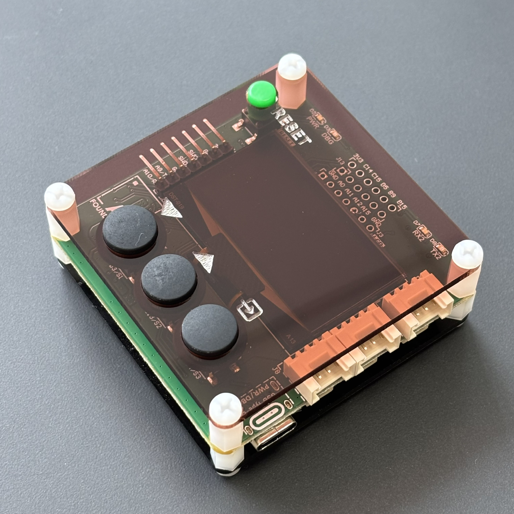</td>
  </tr>
</table>
<p align="center"><strong><em>Figure 1:</em></strong> AK Embedded Base Kit - STM32L151</p>

The [AK Embedded Base Kit](https://epcb.vn/products/ak-embedded-base-kit-lap-trinh-nhung-vi-dieu-khien-mcu) is an evaluation board for intermediate and advanced embedded programming.

Its **1.54-inch OLED**, **three push buttons**, and **buzzer** provide the display, controls, and sound for a compact handheld game. **RS485**, **Qwiic**, and **Grove** connections are also available for other firmware experiments.

**MCU Overview:**

```text
SoC Name : STM32L151CBT6
RAM      : 16 KB

Flash Partitions Layout
-----------------------
[ 0x08000000 - 0x08001FFF ] : Bootloader Partition (8 KB)
=> AK Bootloader

[ 0x08002000 - 0x08002FFF ] : BSF Shared Partition (4 KB)
=> Data shared between Bootloader and Application

[ 0x08003000 - 0x0801FFFF ] : Application Partition (116 KB)
=> Eleven Meter firmware
```

**MCU Naming Convention:**

<div align="center">

| Part | Meaning |
| --- | --- |
| `STM32` | STMicroelectronics 32-bit MCU family. |
| `L` | Low-power series. |
| `151` | STM32L151 product line. |
| `C` | 48-pin package. |
| `B` | 128 KB Flash memory. |
| `T` | LQFP package. |
| `6` | Industrial temperature grade. |

</div>

<table align="center">
  <tr>
    <td align="center"></td>
  </tr>
</table>
<p align="center"><strong><em>Figure 2:</em></strong> Board view Top + Bottom</p>

### II. Game Description and Objects

This section describes the gameplay, screens, and objects of **Eleven Meter**.

<table align="center">
  <tr>
    <td align="center">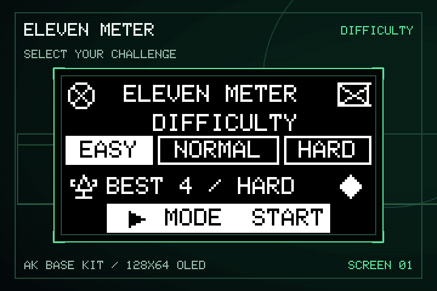</td>
  </tr>
</table>
<p align="center"><strong><em>Figure 3:</em></strong> Menu screen</p>

The game opens on the **difficulty menu**, which provides:

- **Easy:** The best chance of beating the goalkeeper.
- **Normal:** A balanced goalkeeper response.
- **Hard:** A higher chance that the goalkeeper matches the shot direction.
- **BEST:** The saved goal record and its difficulty.
- **Start:** Press **[Mode]** to begin a five-kick match with the selected difficulty.

<table align="center">
  <tr>
    <td align="center">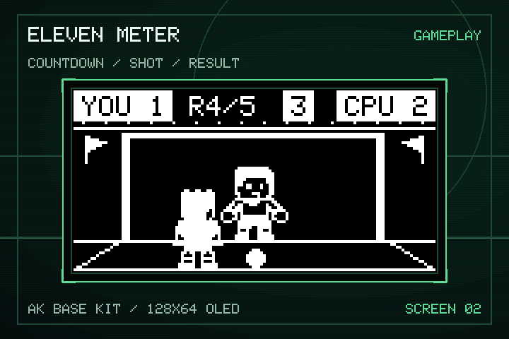</td>
  </tr>
</table>
<p align="center"><strong><em>Figure 4:</em></strong> Gameplay screen</p>

#### Objects in the Game:

<div align="center">
<table>
  <thead>
    <tr>
      <th align="center">Bitmap</th>
      <th align="center">Object Name</th>
      <th align="center">Description</th>
    </tr>
  </thead>
  <tbody>
    <tr>
      <td align="center" valign="middle">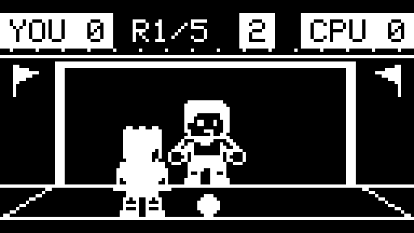</td>
      <td align="center"><strong>Match</strong></td>
      <td align="left">Coordinates the menu, round setup, countdown, accepted input, result phase, and screen transitions.</td>
    </tr>
    <tr>
      <td align="center" valign="middle">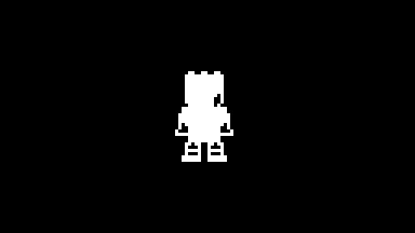</td>
      <td align="center"><strong>Shooter</strong></td>
      <td align="left">Owns kick selection and a short two-pixel step using the original standing bitmap.</td>
    </tr>
    <tr>
      <td align="center" valign="middle"></td>
      <td align="center"><strong>Ball</strong></td>
      <td align="left">Moves from the penalty spot toward the chosen target. A rushed kick may travel wide.</td>
    </tr>
    <tr>
      <td align="center" valign="middle">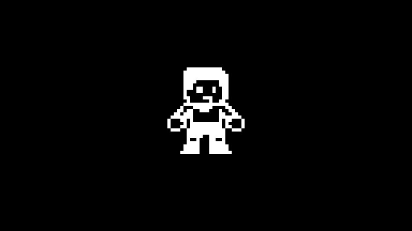</td>
      <td align="center"><strong>Keeper</strong></td>
      <td align="left">Chooses a dive from the shot direction and current difficulty, then animates the save attempt.</td>
    </tr>
    <tr>
      <td align="center" valign="middle">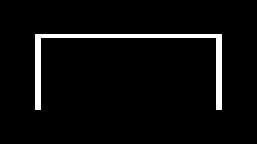</td>
      <td align="center"><strong>Goal</strong></td>
      <td align="left">Waits for the Ball and Keeper reports, then resolves the kick as a goal, save, or miss.</td>
    </tr>
    <tr>
      <td align="center" valign="middle">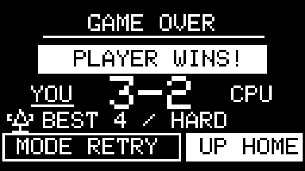</td>
      <td align="center"><strong>Scoreboard</strong></td>
      <td align="left">Tracks five rounds, all kick results, and the final winner.</td>
    </tr>
  </tbody>
</table>
</div>

> **Note:** For detailed object flows, see [Game Object Sequences](docs/02-design-sequence-object.md).

### III. How to Play:

- On the menu, press **[Up]** or **[Down]** to choose Easy, Normal, or Hard.
- Press **[Mode]** to start the shootout.
- During a round, use the buttons from left to right as you face the OLED: **[Down] → left**, **[Up] → center**, **[Mode] → right**. Menu and Game Over controls remain unchanged.
- Choose before the three-second countdown ends. If time runs out, the shot goes to the center.

#### Game Mechanics:

- **Five kicks:** Every match contains five penalty attempts.
- **Winning:** Score at least three goals out of five. Saves and misses both count toward the CPU score.
- **Three results:** A kick ends as a goal, save, or miss.
- **Reaction pressure:** Shooting too quickly increases the chance of missing the target.
- **Difficulty:** The selected level changes how often the goalkeeper matches the shot direction.
- **Score:** The HUD shows the player score, CPU score, round number, and selection countdown.
- **Best result:** The highest goal count is stored together with its difficulty. An equal goal count on a harder difficulty replaces the previous record.
- **Animation:** The original standing shooter takes a two-pixel step, the ball follows the shot, and the goalkeeper animates the response.
- **Game Over:** After the fifth result, a short **Full Time** transition leads to the final score, with two actions:

    - **Retry:** Press **[Mode]** to play another match.
    - **Home:** Press **[Up]** to return to the difficulty menu.

> **Note:** Try to improve BEST, or match it at a harder difficulty.

<table align="center">
  <tr>
    <td align="center">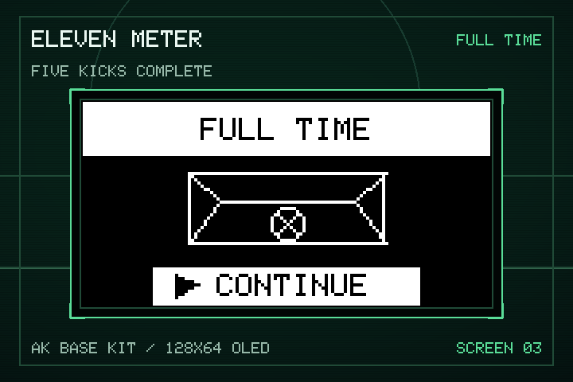</td>
  </tr>
</table>
<p align="center"><strong><em>Figure 5:</em></strong> Full Time transition screen</p>

<table align="center">
  <tr>
    <td align="center">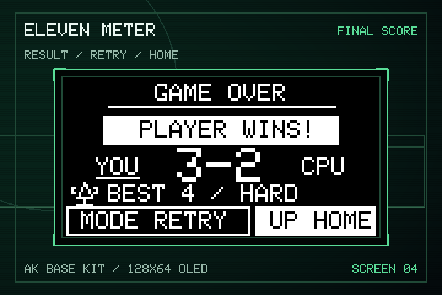</td>
  </tr>
</table>
<p align="center"><strong><em>Figure 6:</em></strong> Game Over screen</p>

### IV. Basic Game Sequence Logic

> **Note:** For the complete signal flow, see [Runtime Signal Processing](docs/03-design-sequence-runtime.md).

<table align="center">
  <tr>
    <td align="center">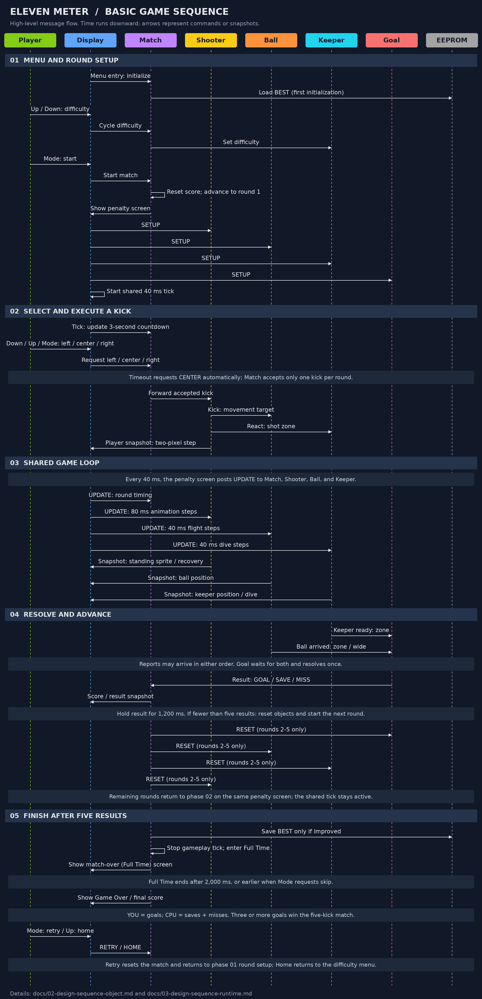</td>
  </tr>
</table>
<p align="center"><strong><em>Figure 7:</em></strong> Game sequence logic</p>

## Contact & Support

<p style="font-size: 20px;"><strong>Cao Trong Phuoc</strong> - Software Engineer - Embedded Systems</p>

```text
Thank you for visiting this repository.
If you have questions, suggestions, or feedback about Eleven Meter or embedded firmware development, feel free to get in touch.
```

<a href="https://github.com/caotrongphuoc">
  
</a>

<a href="https://www.linkedin.com/in/cao-trong-phuoc/">
  
</a>
