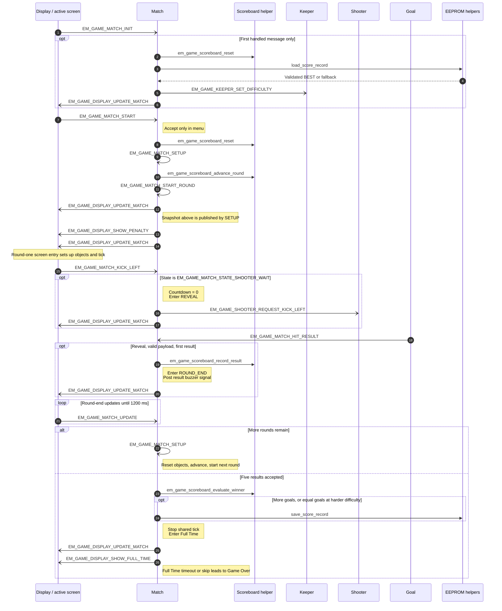
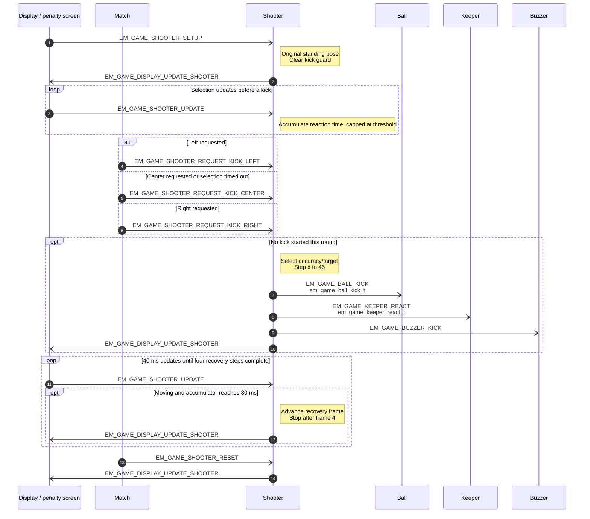
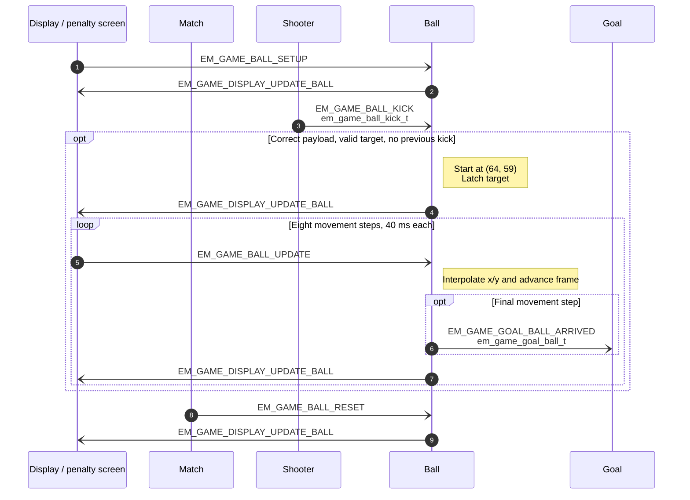
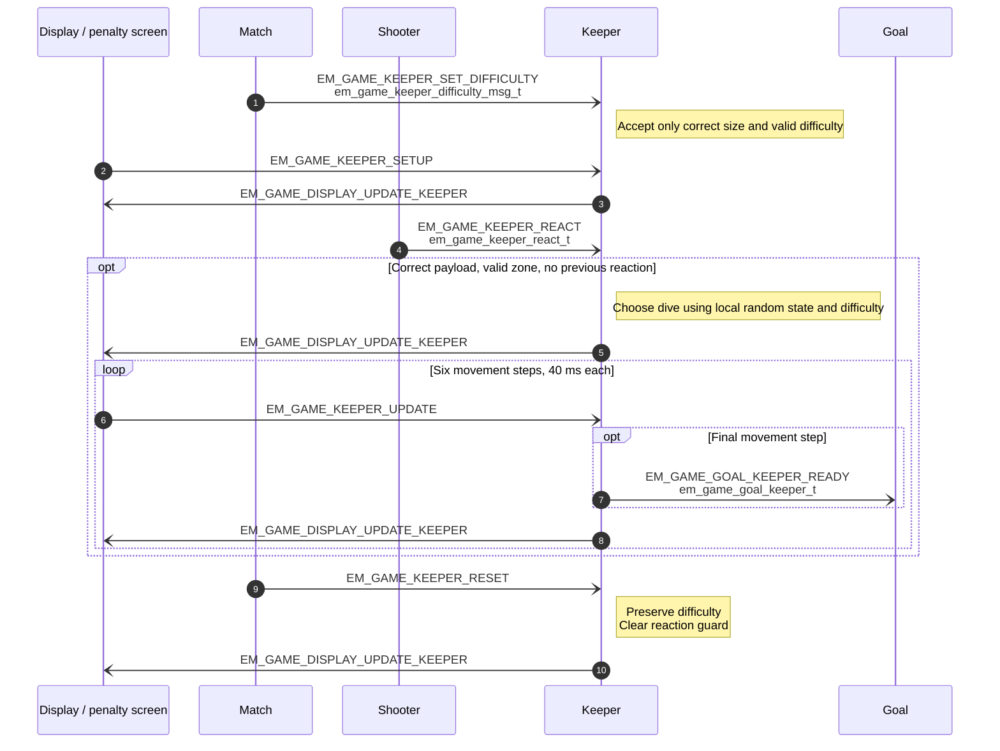
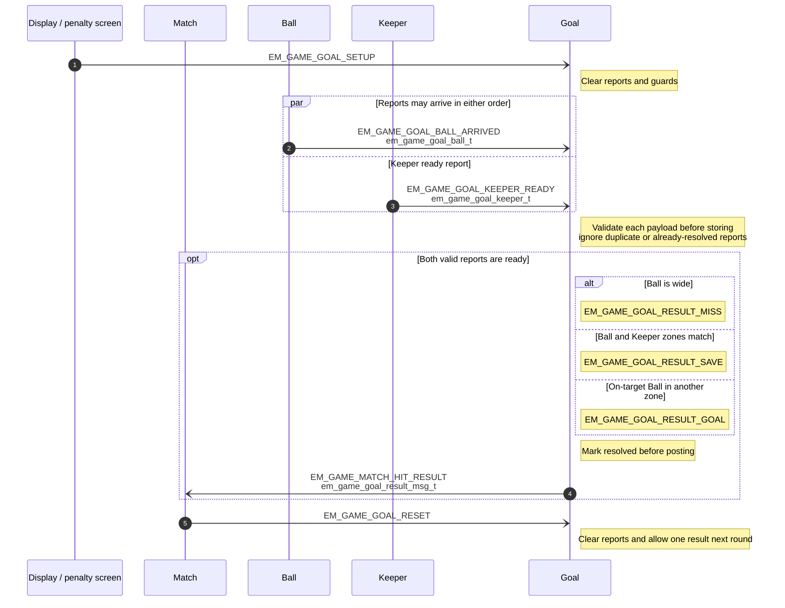
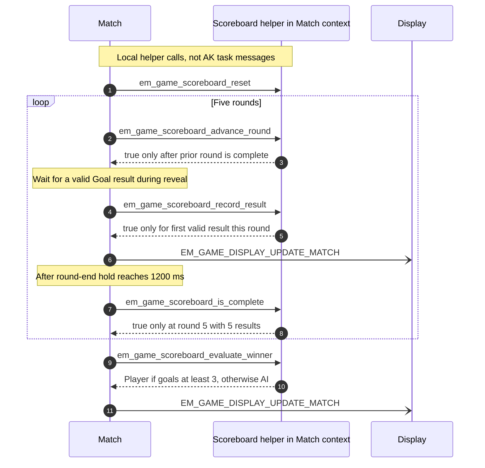
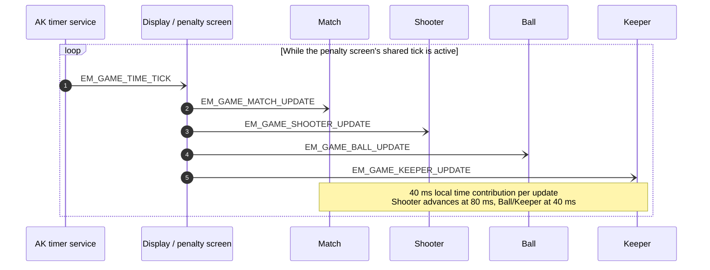

<h1 align="center">Game Object Sequences</h1>

This document describes each Eleven Meter object's owned state, setup, input, updates,
outgoing messages, and reset behavior. Gameplay tasks keep mutable state private and
communicate through AK messages. Scoreboard is a helper operating on Match-owned data,
not a separate task. Display is the rendering task, not a gameplay object.

In the diagrams, `-)` means an asynchronous posted message. `->>` and dashed return
arrows represent local helper calls and results, not direct calls between gameplay
tasks. A Display lifeline includes its active screen callbacks. Diagrams show causal
flows; posting order does not guarantee immediate execution by the receiving task.

## I. Object Summary

| Object | Task ID | Handler or helper | Main responsibility |
|---|---|---|---|
| Match | `EM_GAME_MATCH_ID` | `em_game_match_handle()` | Own rounds, accepted input, countdown, scoreboard, BEST, and screen transitions. |
| Shooter | `EM_GAME_SHOOTER_ID` | `em_game_shooter_handle()` | Select shot accuracy, animate the standing player, and command Ball and Keeper. |
| Ball | `EM_GAME_BALL_ID` | `em_game_ball_handle()` | Move toward the selected target and report arrival to Goal. |
| Keeper | `EM_GAME_KEEPER_ID` | `em_game_keeper_handle()` | Choose and animate a dive, then report readiness to Goal. |
| Goal | `EM_GAME_GOAL_ID` | `em_game_goal_handle()` | Resolve one validated Ball report and one Keeper report into a kick result. |
| Scoreboard | None; owned by Match | `em_game_scoreboard_*()` | Track one result per round, five attempts, and the winner. |

`scr_game_penalty` handles the single periodic `EM_GAME_TIME_TICK` on Display every
40 ms, posting updates in the order Match → Shooter → Ball → Keeper. Goal is driven
by incoming reports; Scoreboard is called locally by Match.

## II. Match Object Sequence

Match owns `s_scoreboard`, the match state, current difficulty, countdown, elapsed state
time, last result, BEST values, and the initialization flag.

**Setup.** On its first handled message, Match resets the scoreboard, reads and validates
the saved BEST record, enters `EM_GAME_MATCH_STATE_MENU`, sends Keeper its difficulty,
and publishes a view. An invalid record gives BEST zero goals on Easy; the current
selection initially remains Normal. Later `EM_GAME_MATCH_INIT` messages do not reload
EEPROM or restart an active match.

**Input.** Menu Up/Down posts `EM_GAME_MATCH_MENU_LEFT` / `EM_GAME_MATCH_MENU_RIGHT`;
these cycle difficulty only in `EM_GAME_MATCH_STATE_MENU`. Each accepted change sends
`EM_GAME_KEEPER_SET_DIFFICULTY` and `EM_GAME_DISPLAY_UPDATE_MATCH`.

`EM_GAME_MATCH_START` from the menu, or `EM_GAME_MATCH_RETRY` from Game Over, clears the
scoreboard and queues `EM_GAME_MATCH_SETUP`. Setup advances one round, then queues
`EM_GAME_MATCH_START_ROUND`. The latter starts the three-second selection phase and
requests `EM_GAME_DISPLAY_SHOW_PENALTY` only for round one.

On the penalty screen, physical positions map as follows:

| Button position | BSP button | Screen → Match | Match → Shooter |
|---|---|---|---|
| Left | Down | `EM_GAME_MATCH_KICK_LEFT` | `EM_GAME_SHOOTER_REQUEST_KICK_LEFT` |
| Middle | Up | `EM_GAME_MATCH_KICK_CENTER` | `EM_GAME_SHOOTER_REQUEST_KICK_CENTER` |
| Right | Mode | `EM_GAME_MATCH_KICK_RIGHT` | `EM_GAME_SHOOTER_REQUEST_KICK_RIGHT` |

Only `EM_GAME_MATCH_STATE_SHOOTER_WAIT` accepts a kick. The first accepted request clears
the countdown and enters `EM_GAME_MATCH_STATE_REVEAL`; further kick requests are ignored.

**Per-tick.** `EM_GAME_MATCH_UPDATE` advances selection time and republishes only when
the visible countdown changes. At 3,000 ms, Match requests a center kick without posting
a synthetic button event. In `EM_GAME_MATCH_STATE_ROUND_END`, the same update signal
holds the result for 1,200 ms before advancing or finishing. Reveal ends on a valid
Goal result, not on a separate animation timeout.

**Cross-task.** Match accepts `EM_GAME_MATCH_HIT_RESULT` only during reveal and only
with the expected payload size and a valid result. Scoreboard must also accept that
round's first result. Match then enters round end, posts the corresponding buzzer
signal, and publishes its view.

**Reset and finish.** For rounds after the first, setup posts these messages in order:
`EM_GAME_GOAL_RESET`, `EM_GAME_BALL_RESET`, `EM_GAME_KEEPER_RESET`, and
`EM_GAME_SHOOTER_RESET`, followed by the self-posted `EM_GAME_MATCH_START_ROUND`.
The penalty screen stays active; it is not re-entered between rounds.

After five results, Match evaluates the winner, saves an improved BEST, stops the
gameplay tick, publishes its Full Time state, requests `EM_GAME_DISPLAY_SHOW_FULL_TIME`, and arms
the one-shot `EM_GAME_MATCH_FULL_TIME_TIMEOUT` for 2,000 ms. That timeout or
`EM_GAME_MATCH_SKIP_FULL_TIME` opens Game Over and plays `EM_GAME_BUZZER_WIN` or
`EM_GAME_BUZZER_LOSE`. Game Over Mode retries; Up posts `EM_GAME_MATCH_HOME`, which
clears the current match and requests the menu. Difficulty and BEST survive Retry/Home.

<strong><em>Figure 1:</em></strong> Match coordination and accepted round results

EEPROM operations are local persistence helpers, not task messages. The save helper's
return value is currently not surfaced by Match; this sequence does not imply a
successful durable write when that helper reports failure.

## III. Shooter Object Sequence

Shooter owns `s_shooter`, its random seed, selection elapsed time, animation accumulator,
and `s_kick_started` guard.

**Setup.** `EM_GAME_SHOOTER_SETUP` parks the player at `(44, 63)`, visible and stationary,
with no kick selected. It clears both time accumulators and the per-round kick guard.
The random seed is initialized only if not already set.

**Input.** Match posts one of `EM_GAME_SHOOTER_REQUEST_KICK_LEFT`,
`EM_GAME_SHOOTER_REQUEST_KICK_CENTER`, or `EM_GAME_SHOOTER_REQUEST_KICK_RIGHT`.
Shooter ignores subsequent requests until reset. It chooses the Ball target with a
10% base miss chance; a request before the local 500 ms reaction threshold adds 20
percentage points, capped at 30%. A missed center shot selects either wide side.

**Cross-task.** On the accepted request, Shooter immediately sends `EM_GAME_BALL_KICK`
with the movement target, `EM_GAME_KEEPER_REACT` with the intended shot zone, and
`EM_GAME_BUZZER_KICK`. Keeper is not told whether the actual Ball target is wide.
The player steps to `(46, 63)` and publishes `EM_GAME_DISPLAY_UPDATE_SHOOTER`.

**Per-tick.** `EM_GAME_SHOOTER_UPDATE` accumulates selection time before the kick and
advances recovery every 80 ms while moving. Four animation steps return x to 44 in
a nominal 320 ms. Display uses the original standing bitmap for every frame; the old
raised-leg and follow-through bitmaps are retained assets, not animation stages.

**Reset.** `EM_GAME_SHOOTER_RESET` restores the setup pose and timing/guard state without
discarding an already initialized random seed. It publishes the restored snapshot.

<strong><em>Figure 2:</em></strong> Shooter selection, dispatch, and standing-sprite recovery

The generated [shooter frame preview](../resources/images/screens/scr_game_shooter_frames.png)
shows the standing pose and small positional step, not new player artwork.

## IV. Ball Object Sequence

Ball owns `s_ball`, `s_target_x`, its update accumulator, and the per-round kick guard.

**Setup.** `EM_GAME_BALL_SETUP` places the visible, stationary ball at `(64, 59)`, clears
its target, resets frame/time counters, and publishes `EM_GAME_DISPLAY_UPDATE_BALL`.

**Input.** `EM_GAME_BALL_KICK` must contain exactly `em_game_ball_kick_t`. A target must
be left, center, right, wide-left, or wide-right; `NONE` and duplicate kicks are ignored.
Ball starts at the penalty spot and records its own target rather than reading Shooter.

**Per-tick.** While moving, `EM_GAME_BALL_UPDATE` advances one interpolation step every
40 ms. The eight steps finish at y = 47, with x = 40/64/87 for on-target shots or
x = 20/108 for wide shots. Nominal flight duration is 320 ms.

**Cross-task.** At completion, Ball stops and posts `EM_GAME_GOAL_BALL_ARRIVED` before
its final display snapshot. The report contains a goal zone and `is_wide`; a wide shot
uses `EM_GAME_GOAL_ZONE_NONE` and `is_wide = 1`. It does not decide goal/save/miss itself.

**Reset.** `EM_GAME_BALL_RESET` restores the penalty spot and clears the kick guard so
the next round can accept one new command. It leaves the ball visible.

<strong><em>Figure 3:</em></strong> Ball command validation, flight, and arrival report

## V. Keeper Object Sequence

Keeper owns `s_keeper`, difficulty, target x, random seed, update accumulator, and the
per-round reaction guard. Its state is independent of Ball and Shooter snapshots.

**Setup.** `EM_GAME_KEEPER_SETUP` restores `(64, 29)`, visible, stationary, and with no
dive selected. Setup/reset clears the reaction guard but preserves difficulty and seed.

**Input.** Match sends `EM_GAME_KEEPER_SET_DIFFICULTY` with an
`em_game_keeper_difficulty_msg_t`; Keeper validates its size and difficulty range.
Shooter sends `EM_GAME_KEEPER_REACT` with an `em_game_keeper_react_t`; Keeper validates
the left/center/right shot zone and accepts only the first reaction per round.

**Dive selection.** A random left/center/right choice is adjusted by difficulty:

- Easy: a matching choice has a 60% chance to change to another direction.
- Normal: retain the initial random choice.
- Hard: a nonmatching choice has a 30% chance to change to the shot direction.

These percentages describe conditional adjustments, not guaranteed save rates.
The intended shot zone does not reveal a wide Ball target.

**Per-tick.** `EM_GAME_KEEPER_UPDATE` advances moving Keeper every 40 ms, for six steps
(nominally 240 ms) toward x = 41/64/87. A center response still completes the six-step
sequence even though x remains 64. Display chooses the idle or dive bitmap from the view.

**Cross-task.** At the final step, Keeper stops, posts `EM_GAME_GOAL_KEEPER_READY` with
the selected zone, and then publishes `EM_GAME_DISPLAY_UPDATE_KEEPER`.

**Reset.** `EM_GAME_KEEPER_RESET` restores the setup pose and permits a new reaction.
Neither reset signal silently changes the difficulty selected in the menu.

<strong><em>Figure 4:</em></strong> Keeper difficulty, dive selection, and ready report

## VI. Goal Object Sequence

Goal owns copies of the Ball and Keeper reports, two readiness flags, and `s_resolved`.
It does not render the goal artwork or inspect another task's coordinates.

**Setup.** `EM_GAME_GOAL_SETUP` clears the reports, readiness flags, and resolved guard.

**Input and cross-task.** Goal accepts `EM_GAME_GOAL_BALL_ARRIVED` and
`EM_GAME_GOAL_KEEPER_READY` in either order. Each message must have the expected size.
Ball must report either an on-target zone with `is_wide = 0`, or zone `NONE` with
`is_wide = 1`. Keeper must report left, center, or right. A duplicate from the same
sender, or any report after resolution, is ignored until reset.

**Resolution.** Once both valid reports are ready:

| Condition | Result |
|---|---|
| Ball is wide | `EM_GAME_GOAL_RESULT_MISS` |
| On-target Ball zone equals Keeper zone | `EM_GAME_GOAL_RESULT_SAVE` |
| Other on-target Ball | `EM_GAME_GOAL_RESULT_GOAL` |

Goal marks the attempt resolved, clears both readiness flags, and posts exactly one
`EM_GAME_MATCH_HIT_RESULT` containing `em_game_goal_result_msg_t`.

**Per-tick.** None. Goal waits for messages; it has no gameplay update timer.

**Reset.** `EM_GAME_GOAL_RESET` performs the same clear operation as setup. Match sends
it before resetting the movement objects for a later round.

<strong><em>Figure 5:</em></strong> Goal report aggregation and one-shot resolution

## VII. Scoreboard Object Sequence

Scoreboard defines `em_game_scoreboard_t` and operations on a pointer supplied by Match.
The actual state is Match's private `s_scoreboard`; there is no Scoreboard task, message
queue, update signal, or independently shared score variable.

**Setup/reset.** `em_game_scoreboard_reset` clears round, goals, saves, misses, and winner.
Match calls it during initialization, Start, Retry, and Home.

**Input.** `em_game_scoreboard_record_result` accepts a valid goal/save/miss only when
the round is nonzero and the current result count equals `round - 1`. A second result
for that round is rejected. `em_game_scoreboard_advance_round` accepts only when the
result count equals the current round and the round is below five.

**Completion.** `em_game_scoreboard_is_complete` requires both round five and exactly
five results. `em_game_scoreboard_evaluate_winner` returns no winner for an incomplete
match, Player for at least three goals, and AI otherwise. CPU score is saves + misses.

**Per-tick/cross-task.** None directly. Match calls these helpers in its own handler
and publishes score/winner fields through `EM_GAME_DISPLAY_UPDATE_MATCH`.

<strong><em>Figure 6:</em></strong> Match-owned Scoreboard operations

## VIII. Per-Tick Signal Order

On penalty `SCREEN_ENTRY`, Display posts `EM_GAME_SHOOTER_SETUP`, `EM_GAME_BALL_SETUP`,
`EM_GAME_KEEPER_SETUP`, and `EM_GAME_GOAL_SETUP`, in that order. It then replaces any
existing `EM_GAME_TIME_TICK` timer with the single 40 ms periodic timer.

For every `EM_GAME_TIME_TICK`, the penalty handler posts:

1. `EM_GAME_MATCH_UPDATE`
2. `EM_GAME_SHOOTER_UPDATE`
3. `EM_GAME_BALL_UPDATE`
4. `EM_GAME_KEEPER_UPDATE`

<strong><em>Figure 7:</em></strong> Shared tick fan-out posting order

This is posting order, not a barrier that waits for all four handlers to finish.
Message-driven reports and snapshots may be queued between ticks. Goal has no update
signal. At match completion, Match cancels the shared timer and pending tick messages;
Full Time uses a separate one-shot transition timeout, not a second periodic gameplay loop.
Canceling the tick does not retract object update messages posted by an earlier tick.

## IX. Message Contracts and Render Snapshots

Common-message payloads must fit within `AK_COMMON_MSG_DATA_SIZE` (64 bytes).
The application does not use compile-time size assertions. Receivers validate length and allowed values before using
payloads. Payloads contain commands or copies, never pointers to mutable task state.

| Sender → Receiver | Signal | Payload |
|---|---|---|
| Match → Keeper | `EM_GAME_KEEPER_SET_DIFFICULTY` | `em_game_keeper_difficulty_msg_t` |
| Shooter → Ball | `EM_GAME_BALL_KICK` | `em_game_ball_kick_t` |
| Shooter → Keeper | `EM_GAME_KEEPER_REACT` | `em_game_keeper_react_t` |
| Ball → Goal | `EM_GAME_GOAL_BALL_ARRIVED` | `em_game_goal_ball_t` |
| Keeper → Goal | `EM_GAME_GOAL_KEEPER_READY` | `em_game_goal_keeper_t` |
| Goal → Match | `EM_GAME_MATCH_HIT_RESULT` | `em_game_goal_result_msg_t` |
| Match → Display | `EM_GAME_DISPLAY_UPDATE_MATCH` | `em_game_match_view_t` |
| Shooter → Display | `EM_GAME_DISPLAY_UPDATE_SHOOTER` | `em_game_shooter_view_t` |
| Ball → Display | `EM_GAME_DISPLAY_UPDATE_BALL` | `em_game_ball_view_t` |
| Keeper → Display | `EM_GAME_DISPLAY_UPDATE_KEEPER` | `em_game_keeper_view_t` |

Display validates snapshot sizes, coordinates, enum/flag ranges, frame bounds, and
score/countdown limits before updating its own render state. Its getter is used only
by screen drawing helpers in the same task context; gameplay objects do not read it.
The Goal artwork belongs to screen rendering, not to Goal's result-resolution state.

## X. Code References

| Module | Source | Header |
|---|---|---|
| Match | [em_game_match.cpp](../application/sources/app/game_eleven_meter/em_game_match.cpp) | [em_game_match.h](../application/sources/app/game_eleven_meter/em_game_match.h) |
| Shooter | [em_game_shooter.cpp](../application/sources/app/game_eleven_meter/em_game_shooter.cpp) | [em_game_shooter.h](../application/sources/app/game_eleven_meter/em_game_shooter.h) |
| Ball | [em_game_ball.cpp](../application/sources/app/game_eleven_meter/em_game_ball.cpp) | [em_game_ball.h](../application/sources/app/game_eleven_meter/em_game_ball.h) |
| Keeper | [em_game_keeper.cpp](../application/sources/app/game_eleven_meter/em_game_keeper.cpp) | [em_game_keeper.h](../application/sources/app/game_eleven_meter/em_game_keeper.h) |
| Goal | [em_game_goal.cpp](../application/sources/app/game_eleven_meter/em_game_goal.cpp) | [em_game_goal.h](../application/sources/app/game_eleven_meter/em_game_goal.h) |
| Scoreboard | [em_game_scoreboard.cpp](../application/sources/app/game_eleven_meter/em_game_scoreboard.cpp) | [em_game_scoreboard.h](../application/sources/app/game_eleven_meter/em_game_scoreboard.h) |
| Penalty screen | [scr_game_penalty.cpp](../application/sources/app/screens/scr_game_penalty.cpp) | [scr_game_penalty.h](../application/sources/app/screens/scr_game_penalty.h) |
| Display integration | [task_display.cpp](../application/sources/app/task_display.cpp) | [task_display.h](../application/sources/app/task_display.h) |

See [Runtime Signal Processing](03-design-sequence-runtime.md) for the complete game
lifecycle, [Coding Rules](01-guide-coding-rules.md) for contribution rules, and
[app.h](../application/sources/app/app.h) for exact signal and timing declarations.
