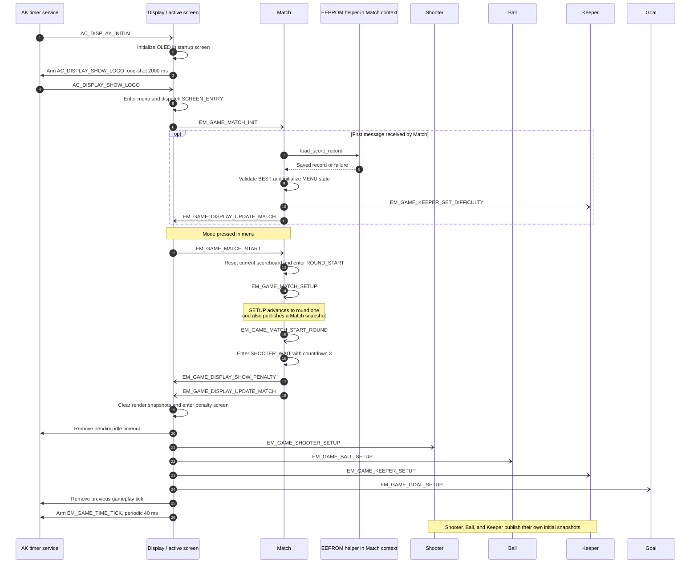
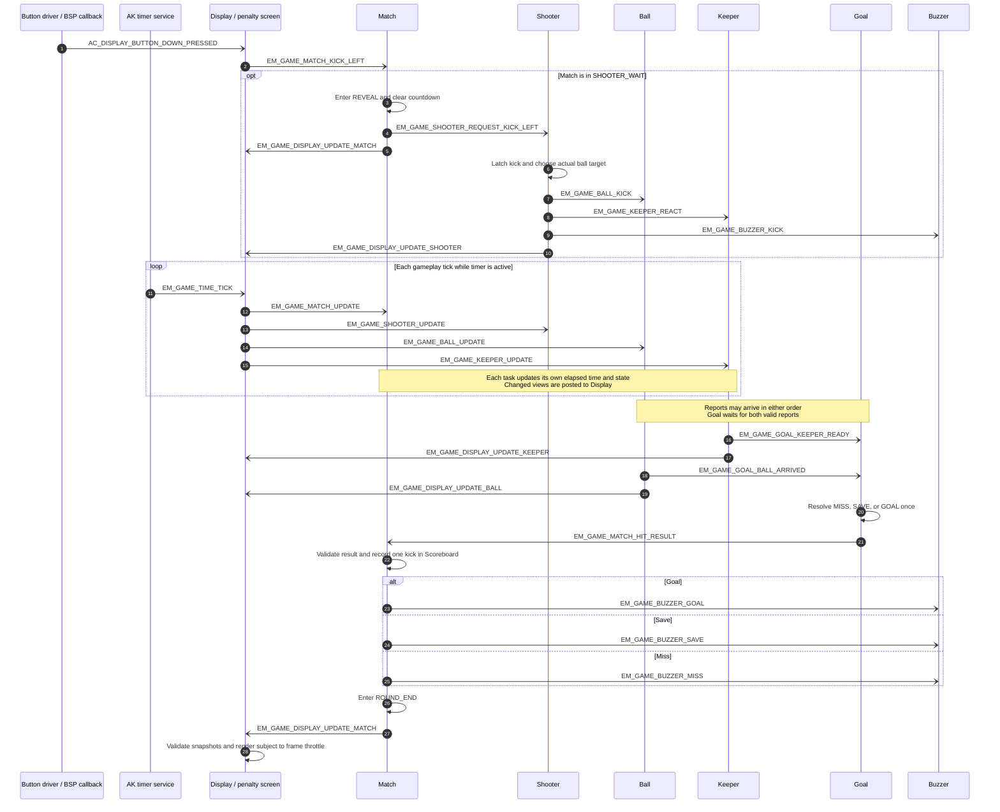
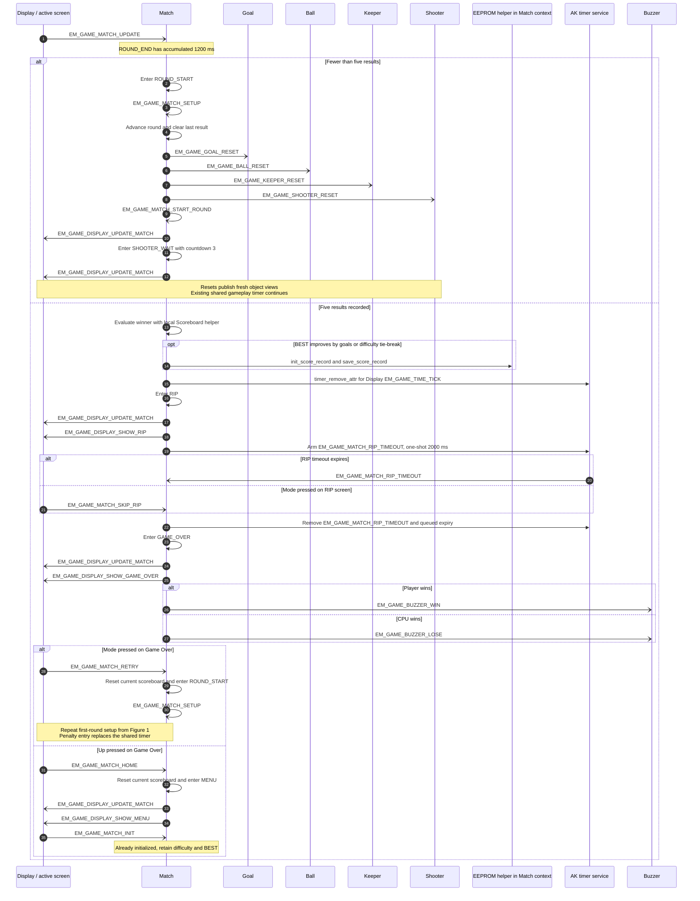

<h1 align="center">Runtime Signal Processing</h1>

This document explains how Eleven Meter processes startup events, button input, shared game ticks, object reports, and screen updates. It follows a match from the menu through five penalty kicks to the final score, Retry, or Home.

For individual object behavior and payload contracts, see [Game Object Sequences](02-design-sequence-object.md).

## I. Overview

Eleven Meter uses AK event-driven tasks. Match, Shooter, Ball, Keeper, and Goal each own private mutable state and receive commands through messages. Scoreboard is a helper owned by Match, not a separate task.

Display (`AC_TASK_DISPLAY_ID`) owns the screen manager and validated render snapshots. Its active screen translates button events into Match commands. The penalty screen distributes the single periodic gameplay tick, `EM_GAME_TIME_TICK`, at `EM_GAME_TIME_TICK_INTERVAL = 40 ms`.

The runtime path is:

1. A button callback or timer posts a signal to its destination task.
2. AK dispatches the queued message to that task's handler.
3. The handler validates the event and updates only its own state.
4. Commands, reports, and render snapshots are posted to other tasks as needed.
5. Display validates snapshots and renders the active screen from its local copies.

In the sequence diagrams, `-)` means an asynchronous message routed through AK. Self-messages are queued, not recursive handler calls. `->>` denotes a local operation or timer API call, not direct access to another gameplay task. Intermediate snapshots are omitted where noted to keep the control flow readable.

### High Level Architecture

#### 1. Game Start

Application startup arms `AC_DISPLAY_INITIAL` for 100 ms. The startup screen initializes the OLED, then arms the 2,000 ms `AC_DISPLAY_SHOW_LOGO` timeout. That timeout enters the game menu; Mode can enter it earlier. This framework startup transition is handled locally by the startup screen. Once in the game, Match coordinates gameplay screen transitions through Display messages.

On menu entry, Display posts `EM_GAME_MATCH_INIT`. Match initializes on its first received message: it clears the current scoreboard, loads and validates the saved BEST record, sends Keeper the selected difficulty, and publishes a Match snapshot. Invalid saved data falls back to BEST 0 / Easy. The initial menu selection remains Normal. Later menu entries do not reload this initialized state.

<strong><em>Figure 1:</em></strong> Startup, menu entry, and first-round setup

Menu difficulty commands wrap through Easy, Normal, and Hard. Match posts `EM_GAME_KEEPER_SET_DIFFICULTY` and `EM_GAME_DISPLAY_UPDATE_MATCH` after each accepted change. Starting a match preserves the selected difficulty and BEST record.

#### 2. Game Playing

The penalty screen maps physical left, middle, and right buttons to left, center, and right kicks. Match accepts a kick only in `EM_GAME_MATCH_STATE_SHOOTER_WAIT`, changes to `EM_GAME_MATCH_STATE_REVEAL`, and forwards the corresponding request to Shooter.

The diagram uses a left kick as an example. Center and right use `EM_GAME_SHOOTER_REQUEST_KICK_CENTER` and `EM_GAME_SHOOTER_REQUEST_KICK_RIGHT`. If no kick is accepted within 3,000 ms of accumulated Match updates, Match directly requests `EM_GAME_SHOOTER_REQUEST_KICK_CENTER` instead.

<strong><em>Figure 2:</em></strong> Accepted kick, shared updates, and result processing

Shooter starts Ball and Keeper immediately. Its animation uses the original standing bitmap with a short two-pixel step, not a separate raised-leg or run-up phase. Ball receives the actual target, which can be wide. Keeper receives the intended shot direction and chooses its response using its own difficulty and random state.

Keeper normally finishes its six movement steps before Ball finishes its eight flight steps. Goal does not assume this ordering: it validates and retains the first report from each sender, resolves only after both arrive, and rejects duplicates after resolution. A wide ball is a miss; otherwise matching ball and keeper zones mean a save, and nonmatching zones mean a goal.

#### 3. Game Reset and Completion

After a result, Match holds `EM_GAME_MATCH_STATE_ROUND_END` for 1,200 ms of accumulated updates. For rounds two through five, it posts object reset signals and starts the next selection phase without re-entering the penalty screen or creating another timer.

After five recorded results, Match evaluates the winner using its Scoreboard helper. Three or more goals wins for the player; otherwise CPU wins. A better goal count, or an equal goal count on a harder difficulty, updates BEST and calls the EEPROM save helper. The current caller does not check the save return value, so this path alone does not prove a successful persistent write.

<strong><em>Figure 3:</em></strong> Next-round reset, match completion, Retry, and Home

Timer removal cancels the periodic timer and purges queued `EM_GAME_TIME_TICK` expiry messages for Display. It does not retract object `UPDATE` messages already posted by earlier ticks. Match's phase checks and each object's local movement or completion guards still apply to queued work.

## II. Code References

Paths below are relative to the repository root.

| Source | Runtime responsibility |
|---|---|
| [app.cpp](../application/sources/app/app.cpp) | Application initialization and startup timers. |
| [app.h](../application/sources/app/app.h) | Signal definitions and timing constants. |
| [app_bsp.cpp](../application/sources/app/app_bsp.cpp) | Button callbacks posting Display input events. |
| [task_list.cpp](../application/sources/app/task_list.cpp) | Task priorities and handler registration. |
| [task_display.cpp](../application/sources/app/task_display.cpp) | Snapshot validation, screen requests, and active-screen dispatch. |
| [scr_startup.cpp](../application/sources/app/screens/scr_startup.cpp) | OLED startup and initial menu transition. |
| [scr_game_menu.cpp](../application/sources/app/screens/scr_game_menu.cpp) | Difficulty and Start input translation. |
| [scr_game_penalty.cpp](../application/sources/app/screens/scr_game_penalty.cpp) | Shared gameplay tick, kick input, and gameplay rendering. |
| [scr_game_rip.cpp](../application/sources/app/screens/scr_game_rip.cpp) | RIP rendering and skip input. |
| [scr_game_over.cpp](../application/sources/app/screens/scr_game_over.cpp) | Final result rendering, Retry, and Home input. |
| [em_game_match.cpp](../application/sources/app/game_eleven_meter/em_game_match.cpp) | Round phases, results, BEST, and gameplay screen coordination. |
| [em_game_shooter.cpp](../application/sources/app/game_eleven_meter/em_game_shooter.cpp) | Kick selection and shooter feedback. |
| [em_game_ball.cpp](../application/sources/app/game_eleven_meter/em_game_ball.cpp) | Flight steps and arrival report. |
| [em_game_keeper.cpp](../application/sources/app/game_eleven_meter/em_game_keeper.cpp) | Difficulty-based response and ready report. |
| [em_game_goal.cpp](../application/sources/app/game_eleven_meter/em_game_goal.cpp) | Joining reports and resolving one kick. |
| [em_game_scoreboard.cpp](../application/sources/app/game_eleven_meter/em_game_scoreboard.cpp) | Match-local round, result, and winner helpers. |
| [app_eeprom.cpp](../application/sources/app/app_eeprom.cpp) | Saved BEST record loading and writing. |
| [screen_manager.cpp](../application/sources/common/screen_manager.cpp) | Read-only framework reference for screen dispatch and render throttling. |

## III. Task Ownership

| Task or helper | Owned state | Runtime output |
|---|---|---|
| Match | Phase, round coordination, countdown, difficulty, last result, BEST, and Scoreboard instance. | Accepted Shooter requests, object resets, Match snapshots, screen requests, and result sounds. |
| Shooter | Kick latch, target selection, reaction time, player pose, and feedback animation. | Ball target, Keeper reaction command, kick sound, and Shooter snapshots. |
| Ball | Flight target, position, frame, and completion latch. | Ball snapshots and one arrival report to Goal. |
| Keeper | Difficulty, response choice, position, frame, and completion latch. | Keeper snapshots and one ready report to Goal. |
| Goal | Validated Ball and Keeper reports, readiness flags, and resolution latch. | One result to Match after both reports. |
| Display | Active screen and validated local render snapshots. | Screen-specific input commands and the four shared-tick updates. |
| Scoreboard helper | No independent task or message queue. Its instance belongs to Match. | Local result recording, round advancement, completion, and winner evaluation. |

Display is presentation infrastructure, not a gameplay object. Screen render helpers may read Display-owned snapshots in the same task context. They do not read mutable gameplay task state. Match may call its local Scoreboard and EEPROM helpers directly, but it does not call another gameplay task to change that task's state.

## IV. Button Event Processing

The BSP posts button events only to `AC_TASK_DISPLAY_ID`:

| Physical button | BSP signal |
|---|---|
| Left / Down | `AC_DISPLAY_BUTTON_DOWN_PRESSED` |
| Middle / Up | `AC_DISPLAY_BUTTON_UP_PRESSED` |
| Right / Mode | `AC_DISPLAY_BUTTON_MODE_PRESSED` |

The active screen determines the command. Directional kick mapping applies only to the penalty screen; menu and result controls keep their own meanings.

| Active screen | Down | Up | Mode |
|---|---|---|---|
| Startup | No game command. | No game command. | Cancel startup timeout and enter menu locally. |
| Menu | `EM_GAME_MATCH_MENU_RIGHT` | `EM_GAME_MATCH_MENU_LEFT` | `EM_GAME_MATCH_START` |
| Penalty | `EM_GAME_MATCH_KICK_LEFT` | `EM_GAME_MATCH_KICK_CENTER` | `EM_GAME_MATCH_KICK_RIGHT` |
| RIP | No game command. | No game command. | `EM_GAME_MATCH_SKIP_RIP` |
| Game Over | No game command. | `EM_GAME_MATCH_HOME` | `EM_GAME_MATCH_RETRY` |

### Button Processing Rules

- Screens translate input into messages, not direct gameplay mutations.
- Match accepts difficulty changes and Start only in `EM_GAME_MATCH_STATE_MENU`.
- Match accepts kicks only in `EM_GAME_MATCH_STATE_SHOOTER_WAIT`. A second press after an accepted kick does not start another shot.
- Match accepts Skip only in `EM_GAME_MATCH_STATE_RIP`, and Retry or Home only in `EM_GAME_MATCH_STATE_GAME_OVER`.
- BSP long-press callbacks only log the event. They do not emit another gameplay command.
- Each pressed callback also rearms the framework idle timeout. Penalty entry removes the pending idle timeout; game screens do not use idle expiry as a round or match transition.

## V. Runtime Scheduling Notes

### Shared Tick and Local Timing

`scr_game_penalty` owns the single periodic `EM_GAME_TIME_TICK` timer on Display. On each tick it posts updates in this order:

1. `EM_GAME_MATCH_UPDATE`
2. `EM_GAME_SHOOTER_UPDATE`
3. `EM_GAME_BALL_UPDATE`
4. `EM_GAME_KEEPER_UPDATE`

This is posting order, not a synchronous four-object function call or completion barrier. AK dispatches messages through task queues. Each task maintains its own elapsed-time accumulator and finishes each handler without blocking. Goal has no tick: report arrival drives resolution.

These are nominal durations from constants and step counts, not measured wall-clock or handler execution times:

| Action | Interval or duration | Runtime behavior |
|---|---|---|
| Shared gameplay tick | 40 ms | Posts the four updates above. |
| Shot selection | 3,000 ms | Match requests a center kick when its selection accumulator expires. |
| Shooter feedback | Four steps at 80 ms | Two-pixel standing-bitmap step and recovery, nominally 320 ms. |
| Ball flight | Eight steps at 40 ms | Arrival report after nominally 320 ms. |
| Keeper response | Six steps at 40 ms | Ready report after nominally 240 ms, including a center response. |
| Result hold | 1,200 ms | Match advances the round or finishes the match. |
| RIP transition | 2,000 ms or Mode | One-shot Match timeout or accepted skip command. |
| Screen render spacing | At least 40 ms | Framework render throttling, not another gameplay update timer. |

Startup, idle, RIP, and deferred-render timers serve separate framework or transition purposes. They do not give Shooter, Ball, Keeper, or Goal individual gameplay timers.

### Render Scheduling

Display validates a received common-message snapshot before copying it into its private render model. Invalid snapshot messages return without updating that model. Valid Display events continue through the screen manager, which dispatches to the active screen and requests rendering.

The framework renders immediately when allowed by its minimum render interval, or schedules a deferred `AC_DISPLAY_RENDER_SCREEN` event. A snapshot is therefore not a guarantee of an immediate OLED refresh. Rendering uses the latest accepted local snapshots, not a cross-task atomic frame or a requirement that every object has completed the same tick.

### Phase and Result Guards

| Match phase | Accepted progress event | Next phase |
|---|---|---|
| `EM_GAME_MATCH_STATE_MENU` | `EM_GAME_MATCH_START` | `EM_GAME_MATCH_STATE_ROUND_START` |
| `EM_GAME_MATCH_STATE_ROUND_START` | `EM_GAME_MATCH_SETUP` advances the round, then self-posted `EM_GAME_MATCH_START_ROUND` starts selection. | `EM_GAME_MATCH_STATE_SHOOTER_WAIT` |
| `EM_GAME_MATCH_STATE_SHOOTER_WAIT` | Accepted directional kick or selection timeout during `EM_GAME_MATCH_UPDATE`. | `EM_GAME_MATCH_STATE_REVEAL` |
| `EM_GAME_MATCH_STATE_REVEAL` | Valid `EM_GAME_MATCH_HIT_RESULT` recorded by Scoreboard. | `EM_GAME_MATCH_STATE_ROUND_END` |
| `EM_GAME_MATCH_STATE_ROUND_END` | Result hold expires during `EM_GAME_MATCH_UPDATE`. | `EM_GAME_MATCH_STATE_ROUND_START` if rounds remain, otherwise `EM_GAME_MATCH_STATE_RIP`. |
| `EM_GAME_MATCH_STATE_RIP` | `EM_GAME_MATCH_RIP_TIMEOUT` or `EM_GAME_MATCH_SKIP_RIP`. | `EM_GAME_MATCH_STATE_GAME_OVER` |
| `EM_GAME_MATCH_STATE_GAME_OVER` | `EM_GAME_MATCH_RETRY` or `EM_GAME_MATCH_HOME`. | `EM_GAME_MATCH_STATE_ROUND_START` or `EM_GAME_MATCH_STATE_MENU`, respectively. |

Common-message consumers validate payload lengths and allowed values before using data. Shooter, Ball, and Keeper latch one kick or reaction per round. Goal accepts one valid report from each object and resolves once. Match accepts the result only in REVEAL, and its Scoreboard helper rejects duplicate or out-of-order result recording. Setup and reset prepare these guards for the next round.

These checks describe current event handling, not a new transaction protocol: payloads do not carry round identifiers. The sequences and timings above are source-derived documentation, not evidence of a new hardware test or measured capture.
