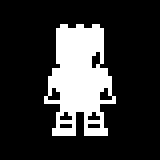
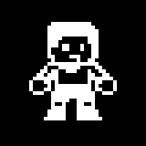
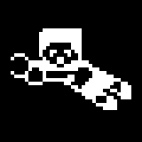
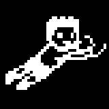
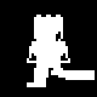
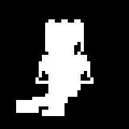

# Eleven Meter bitmap and animation GIFs

The isolated sprite previews are documentation exports from the unchanged arrays in
[`screens_bitmap.cpp`](../../../application/sources/app/screens/screens_bitmap.cpp).
They do not change firmware or sprite data. The Match GIF below is a separate recording
of actual OLED framebuffer samples from the kit.

## Full match


This records all five rounds, the Match Over transition, and the final score, using
normal timeout shots and the keeper's normal random choice. It is a sampled sequence,
not a native-frame-rate video: the temporary capture build pauses the existing gameplay
timer during each UART dump. Playback uses the 160 ms intervals between dumps and a
two-second final-score hold. See [capture provenance and raw frames](../../captures/README.md#full-match-gif).

## Current object movement

| Object | GIF | Behavior |
|---|:---:|---|
| Shooter |  | Uses only the original standing bitmap; moves forward two pixels and returns in four 80 ms steps. No raised-leg pose. |
| Ball |  | Uses the original 7×7 ball, following a right-side shot in eight 40 ms steps. |
| Keeper |  | Shows idle, a left dive, reset, then a right dive; each dive uses six 40 ms movement steps. |

Movement coordinates, step counts, and intervals are read from the current game headers,
`app.h`, and penalty screen constants. Idle/endpoint holds are extended so each pose is
easy to inspect. Left and right dives illustrate separate rounds, not a mid-shot change
of direction. Match and Scoreboard have no standalone object bitmap. Display is the
rendering task, not a gameplay object.

## Original gameplay bitmap inventory

Every source bitmap below is exported as a single-frame GIF, enlarged 4× with
nearest-neighbor scaling. Its pixels and orientation are preserved. Static assets do not
blink or acquire animation frames that are absent from the firmware.

| Source symbol | Native size | Used by current gameplay | GIF |
|---|---|---|:---:|
| `bitmap_penalty_shooter_prepare` | 40×40 | Yes; the standing player in every shooter frame |  |
| `bitmap_penalty_ball` | 7×7 | Yes |  |
| `bitmap_penalty_keeper_idle` | 40×40 | Yes; idle and center response |  |
| `bitmap_penalty_keeper_dive_left` | 40×40 | Yes |  |
| `bitmap_penalty_keeper_dive_right` | 40×40 | Yes |  |
| `bitmap_penalty_goal` | 93×38 | Yes; goal artwork drawn by Display |  |

<details>
<summary>Retained original shooter poses — not used in the current game animation</summary>

| Source symbol | Native size | Status | GIF |
|---|---|---|:---:|
| `bitmap_penalty_shooter_kick` | 40×40 | Retained asset only; not displayed |  |
| `bitmap_penalty_shooter_follow` | 40×40 | Retained asset only; not displayed |  |

</details>

The legacy welcome-screen dolphin declaration is outside the Eleven Meter gameplay asset
set and is not included in this gallery.

## Regenerate

The README's Objects table uses plain, centered copies in [`table/`](table/), all
512×288 pixels displayed at 256×144. This equalizes row sizes without decorative frames
or stretching the source images. Shooter and Keeper share the same sprite scale; the
ball preview is enlarged an additional 2× with nearest-neighbor sampling for visibility.
Source files, sprite geometry, animation frame order, and durations are unchanged.

From the repository root, with Pillow installed:

```bash
python3 tools/render_game_objects.py
python3 tools/render_object_table.py
```

`render_game_objects.py` validates each bitmap's byte count, uses the firmware's row-major MSB-first
packing, and exports eight single-frame asset GIFs, three movement GIFs, and the Match
GIF from its saved UART samples. Animation
frames use a fixed black/white palette and clear the previous frame to prevent trails.
`render_object_table.py` then creates six equal-size table previews, leaving the raw
exports intact.
